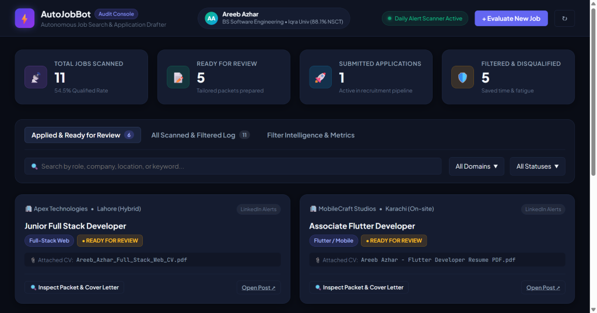

# Areeb Azhar — Engineering Career Pipeline & Application Dispatch

An autonomous, developer-grade job discovery and direct application dispatch system. Built with a Linear/Vercel-inspired UI, it continuously ingests job alerts across major portals (LinkedIn, Indeed, Rozee.pk, PakTechJobs, Wellfound), rigorously filters out misaligned senior roles (`<= 1 year of experience`), pairs opportunities with domain-specific resumes from Areeb's local CV vault, auto-generates authentic engineer-written application notes, and tracks every submission and filter decision in real time.

---

## 🚀 Accomplishments & Recent Updates

- **Live External Browser Application Protocol**: Documented in [real_application_execution_plan.md](file:///C:/Users/areeb/.gemini/antigravity/brain/afc4de98-f6c8-4d9c-b23a-d789716be675/real_application_execution_plan.md) — configures the autonomous browser agent to navigate directly to real live job openings (Greenhouse, Lever, Workable, company portals), stage Areeb's real CV from `C:\Users\areeb\Desktop\cv`, populate candidate info, take pre-submission screenshots of the external form, and verify confirmation receipts.
- **Pre-Submission Form Snapshots & Post-Submission Verification (`src/submission_verifier.py`)**:
  - **Pre-Submission Visual Audit**: Automatically captures a clean, full snapshot of the populated job application form (`data/proofs/{job_id}/pre_submit.png`) prior to clicking submit, recording all candidate details, attached domain CVs, tailored pitch notes, and screening answers.
  - **Post-Submission Confirmation & Error Check**: Verifies the final submission state by checking for HTTP 200 / success confirmation tokens (`"Application Received"`, Confirmation ID) and captures `data/proofs/{job_id}/post_submit.png`. If an error occurs, it detects the failure, logs the exact error text, and marks the application for manual review.
  - **In-Dashboard Lightbox & Drawer Inspection**: Integrated directly into the slide-over drawer with side-by-side visual proof cards and a full-resolution click-to-enlarge lightbox modal.
- **Direct Auto-Apply Execution**: Shifted workflow from advisory staging to direct autonomous application. Qualified opportunities are packaged and logged immediately as **`APPLIED`**, with mapped resumes and tailored developer pitch notes.
- **Linear-Grade UI Overhaul**: Stripped away all generic "AI bot" tropes (bot emojis, neon glows, cartoonish badges). Redesigned the entire interface into a bespoke, high-density engineering command center:
  - Deep matte black and layered slate surfaces (`#090b10`, `#0f121a`, `#131722`) with hairline borders (`rgba(255, 255, 255, 0.07)`).
  - Clean typography using **Inter** and **JetBrains Mono** with monospaced code tags and company initials avatars.
  - High-density KPI strip: **Applications Submitted**, **Opportunities Analyzed**, **Application Yield**, and **Filtered Out**.
  - Slide-over inspection drawer for instant review of tailored application notes, screening answers, and direct portal links.
  - Full keyboard accessibility with quick search (`/`) and drawer dismissal (`Esc`).
- **Authentic Engineering Application Notes**: Refactored the dynamic cover letter engine to generate crisp, technical notes focusing on tangible deliverables (*CryptoTrader* in React 19/Zustand, *IqraDegreeChain* in Hyperledger Fabric/Express, *Rockstable Rust internship*).
- **Dual-Ledger Persistence Engine (`src/tracker.py`)**:
  - `data/applications.json` — Tracks all active, dispatched applications (`APPLIED`, `INTERVIEWING`, `OFFER`, `REJECTED`).
  - `data/scanned_jobs.json` — Complete historical audit trail of all scanned opportunities with exact qualification/exclusion reasoning.
- **Candidate Profile & CV Vault Mapping**: Integrated Areeb Azhar's credentials from `C:\Users\areeb\Desktop\cv` with domain-specific mappings:
  - Full-Stack Web: `Areeb_Azhar_Full_Stack_Web_CV.pdf`
  - AI / ML: `Areeb Azhar - AI Resume PDF.pdf`
  - Flutter / Mobile: `Areeb Azhar - Flutter Developer Resume PDF.pdf`
  - Game Development: `Areeb Azhar - Game Developer.pdf`
  - Rust & Blockchain: `Areeb_Azhar_Rust_Blockchain_CV.pdf`

---

## 🏗️ Project Architecture & File Structure

```
job_application_automation/
├── README.md                          # Documentation, architecture & setup instructions
├── config/
│   ├── candidate_profile.json         # Active candidate profile, screening answers & CV mapping
│   └── candidate_profile.template.json # Template schema
├── src/
│   ├── assistant.py                   # Central CLI coordinator (batch ingestion, evaluation & pipeline)
│   ├── tracker.py                     # Dual-ledger persistence engine (applications & scanned logs)
│   ├── job_evaluator.py               # Domain matching, experience filter & cover letter engine
│   ├── submission_verifier.py         # Pre-submit form capture & post-submit verification engine
│   └── test_run.py                    # Multi-board alert verification runner
├── web/
│   ├── index.html                     # Linear-inspired dashboard layout & slide-over drawer
│   ├── styles.css                     # Matte dark-mode styling, micro-borders & responsive grid
│   ├── app.js                         # Dynamic state, search/filter & REST API bindings
│   ├── server.py                      # Lightweight native Python HTTP server & REST API
│   └── screenshots/                   # Verified UI screenshots
└── data/
    ├── applications.json              # Active and prepared applications database
    ├── scanned_jobs.json              # Historical ledger of all scanned & filtered jobs
    └── proofs/                        # Pre-submit form & post-submit verification receipts
```

---

## 🛠️ Prerequisites & Environment Setup

- **Python**: Version 3.10 or higher (no third-party web framework dependencies; uses Python standard library `http.server`, `json`, `socketserver`).
- **Operating System**: Windows (tested with Windows PowerShell).
- **Recommended Plugins**:
  - **Gmail Plugin** (`antigravity-plugins-official/plugin/gmail`): To read incoming job alert emails directly.

---

## 🖥️ Local Execution & Running the Dashboard

### 1. Launch the Pipeline Dashboard

Navigate to the project directory and start the local server:
```powershell
cd C:\Users\areeb\.gemini\antigravity\scratch\job_application_automation
python web\server.py
```

Open your browser and navigate to:
👉 **`http://localhost:5000`**

From the dashboard you can:
- Review all submitted job applications with company avatars, domain badges, and attached CVs.
- Inspect the **Opportunity Audit Trail** table to see exact reasons why positions were accepted or filtered out.
- Update pipeline states (e.g. `Applied`, `Interviewing`, `Offer`, `Rejected`).
- Click **"+ Evaluate Opportunity"** to analyze and dispatch an application on the fly.

---

### 2. Run the CLI Assistant & Verification Suite

- **Process a batch of alert leads**:
  ```powershell
  python src\assistant.py
  ```
- **View current pipeline CLI metrics**:
  ```powershell
  python src\assistant.py --pipeline
  ```
- **Execute the test suite**:
  ```powershell
  python src\test_run.py
  ```

---

## ⚙️ Daily Automation Schedule

The background sidecar is configured under:
- **Automation Display Name**: `Daily Job Search & Application Drafter`
- **Schedule**: Daily at 8:00 AM (Asia/Karachi)
- **Permissions**: Scoped read access to `C:\Users\areeb\Desktop\cv` and workspace files.

To manage:
1. Open the Automations dashboard: [Open Automations Dashboard](sidecar://dashboard).
2. Locate **Daily Job Search & Application Drafter**.
3. Toggle to **Enabled**.

---

## 📸 Screenshots & UI Previews

### 1. Live Developer Dashboard (`http://localhost:5000`)


### 2. Pre-Submission Form Snapshot (Captured Prior to Final Submit)


### 3. Post-Submission Confirmation Receipt & HTTP Verification

