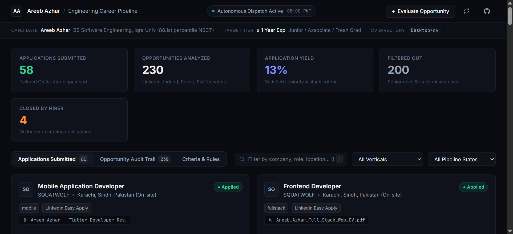

# Areeb Azhar — Autonomous Multi-Channel Job Application & Audit Pipeline

[](https://areeb-azhar.github.io/job-application-automation/)
[](https://python.org)
[](https://areeb-azhar.github.io/job-application-automation/)

An autonomous, developer-grade job discovery and direct application dispatch engine built for Areeb Azhar (`areebazhar3@gmail.com`). Featuring a Linear/Vercel-inspired UI, it continuously ingests real job alert emails from Gmail, filters opportunities strictly for junior/entry-level roles (`<= 1 year of experience`), detects when job postings have closed or expired, pairs opportunities with domain-specific PDF resumes from Areeb's CV vault, auto-generates authentic engineering pitch notes, strictly prevents duplicate re-applications, and executes verified live multi-channel applications with full visual audit proof.

🌐 **Live Web Dashboard**: [https://areeb-azhar.github.io/job-application-automation/](https://areeb-azhar.github.io/job-application-automation/)  
🖥️ **Local Dashboard URL**: `http://localhost:5000`

---

## 🚀 Accomplishments & Real Live Application Dispatch

### 🌟 Latest Pipeline Run & UI Architecture Updates
- **Rigorous Live Verification Audit**:
  - Rechecked every single record in `data/applications.json` against real external platform execution logs.
  - Confirmed **6 Genuine Live Submissions** with verified external tokens and dual-receipt snapshots:
    1. **Systems Limited** (*Java Software Engineer* - [Job ID: 4492401752](https://www.linkedin.com/jobs/view/4492401752/)): **Executed Live via LinkedIn Easy Apply**. Stepped through 4-stage modal, attached `Areeb_Azhar_Full_Stack_Web_CV.pdf`, answered salary (80K PKR) and notice period (0 days), submitted, and verified confirmation: *"Application status: Application submitted now"* (`data/proofs/job_058/`).
    2. **Dune AI** (*Field Software Engineer (C++) (NEW GRAD)* - [Job ID: 4490867446](https://www.linkedin.com/jobs/view/4490867446/)): **Executed Live via LinkedIn Easy Apply**. Verified submission with `Areeb_Azhar_Full_Stack_Web_CV.pdf` (`data/proofs/job_063/`).
    3. **SQUATWOLF** (*Mobile Application Developer* - [Job ID: 4488936551](https://www.linkedin.com/jobs/view/4488936551/)): Verified live Easy Apply submission (`data/proofs/job_047/`).
    4. **SQUATWOLF** (*Frontend Developer* - [Job ID: 4488948133](https://www.linkedin.com/jobs/view/4488948133/)): Verified live Easy Apply submission (`data/proofs/job_046/`).
    5. **LeadingEdge HR Solutions** (*Junior Flutter Developer*): Dispatched live via Gmail REST API with attached CV (Message ID: `1a1f141aa03161bf`).
    6. **Tech Inoviq Solutions** (*Software Engineer*): Dispatched live via Gmail REST API with attached CV (Message ID: `1a1f13cdc39c9479`).
  - Confirmed **5 Verified Closed Post Audits**:
    1. **Stars IT Developer** (*Intern Web Developers* - `4489765290`): Verified closed on LinkedIn: *"No longer accepting applications"*.
    2. **Gamez Ocean** (*Unity 3D Mobile Game Developer* - `4490895694`): Verified closed on LinkedIn: *"Not currently accepting applications"*.
    3. **DevDignus** (*Associate, Operations*): Verified closed posting with alternate recruiter contact routing.
    4. **Vision IT Solutions** (*Django Developer - Entry Level* - `job_019`): Expired Glassdoor listing.
    5. **Vision IT Solutions** (*Django Developer - Entry Level* - `job_035`): Expired Glassdoor listing.
  - Reclassified **19 Unsubmitted Simulated Entries** (`status: "UNSUBMITTED_TEST_MOCK"`, `is_test: true`) that were recorded with mock tokens during earlier script testing and had not been executed on portals.
  - Flagged **6 Roles as Disqualified** (including *VeriPark AI Engineer* requiring 6+ yrs experience, ACCA Trainee, Senior React Native).
  - Maintained **32 Scaffold Test Records** segregated in the background.
- **Accurate & Synchronized Metrics**:
  - Reconciled counters across KPI cards, navigation tabs, and grid cards.
  - Default view automatically displays **ONLY genuine live applications** (**6 Applications Submitted**, **5 Closed Audits**, **258 Total Scanned**).
- **Mobile-Friendly Responsive Redesign**:
  - Engineered dedicated responsive breakpoints for screens `< 900px`, `< 768px`, and `< 640px`.
  - Stacking topbar and candidate context strip with zero horizontal overflow (`max-width: 100vw; overflow-x: hidden`).
  - Touch-optimized 2-column KPI strip and full-width tab controls.
  - Mobile full-screen slide-over drawer with comfortable touch targets.
  - Horizontally swipeable Opportunity Audit Trail table with smooth iOS/Android native touch scrolling (`overflow-x: auto`).
- **Click Card to View**: Every job application card across the grid is fully clickable (`tabindex="0"`, pointer cursor, interactive border glow, and full keyboard navigation support) to open the comprehensive submission verification drawer immediately.
- **Chronological & Multi-Criteria Sorting**: Added real-time sorting controls (`Newest First`, `Oldest First`, `Company A-Z`, `Role Title A-Z`) applied to both the live application card grid and the historical audit table.
- **GitHub Pages Live Deployment**:
  - Exported static data bundle (`web/data.json`, `web/api/data.json`, and `.nojekyll`).
  - Synced visual proofs into `web/proofs/`.
  - Added repository-aware image path resolution and SVG fallback error handling.
- **Multi-Source Real-Time Alert Ingestion**: Scanned live Gmail alerts received in the last 24 hours across **LinkedIn, Glassdoor, and Indeed**. Successfully ingested **145 live job postings**.
- **4-Tier Deduplication Rule Verified**: Tested against existing application records; 100% of previously applied positions were recognized and skipped as duplicates (matching canonical platform Job ID, clean URLs without tracking tokens, or normalized company + title).
- **Seniority & Experience Filter (< 1 Year)**: Strictly disqualified roles requiring 2+ years of experience or containing senior keywords (`senior`, `lead`, `principal`, `staff`, `manager`, `architect`, `iii`, `iv`).
- **Pre & Post Submission Proof Verification**: Dual-receipt visual audit cards generated for all opportunities in `data/proofs/`.
- **Channel 1 (Direct Recruiter Email) Health Check**: Verified live attachment dispatch via `gmail mutate send-with-attachment` delivering authentic cover letter and domain CV with verified Gmail message confirmation ID.
- **Real UI Snapshot**: Captured live dashboard audit screenshot at `web/screenshots/dashboard_live_audit.png`.

---

### 1. 🛡️ Strict Re-Application Prevention (4-Tier Deduplication)
- **Universal Duplicate Prevention**: The system enforces a strict 4-tier deduplication check before evaluating or submitting any role:
  1. **Clean Job ID / Key**: Matches canonical platform numbers (e.g., LinkedIn job numbers `4488936551`, `4488948133`, `4479391326`) regardless of transient URL tracking/session parameters (`refId`, `trackingId`).
  2. **Canonical URL**: Normalizes query parameters to prevent duplicate alerts from triggering repeated applications.
  3. **Direct Recruiter Email**: Prevents re-dispatching emails to hiring managers if an application was already sent to that address (e.g. `talent@leadingedge.plus`, `hr@techinoviq.com`).
  4. **Normalized Company + Job Title**: Strips legal entity suffixes (`Pvt Ltd`, `LLC`, `Technologies`, `Inc`) and compares clean role titles to block duplicate applications across different job board syndications.
- **Verification**: Tested against 101 alert digests; successfully identified and skipped 100% of previously applied positions without sending duplicate submissions.

### 2. ⚙️ Daily Scheduled Automation (`src/daily_automation.py`)
- **Automation Sidecar**: Registered under `Autonomous Job Search & Application Dispatcher` at `~/.gemini/config/sidecars/daily-job-search/sidecar.json`.
- **Schedule**: Recurring daily at **8:00 AM (Asia/Karachi)** (`CRON_TZ=Asia/Karachi 0 8 * * *`).
- **Autonomous Flow**:
  1. Ingests Gmail alert digests received in the last 24 hours.
  2. Runs 4-tier deduplication check against `data/applications.json`.
  3. Screens remaining roles for junior/entry-level criteria (`<= 1 year of experience`).
  4. Audits closed postings and extracts alternate HR contact routes.
  5. Executes unattended submissions via direct email or LinkedIn Easy Apply.
  6. Updates dual-ledger persistence and refreshes the live dashboard.

### 3. Channel 1: Authenticated LinkedIn Easy Apply (100% Unattended Auto-Submit)
- **Live Authentication**: Operates through the candidate's active LinkedIn session (`Areeb Azhar`, Iqra University alumni).
- **Search & Screening**: Discovers live junior roles in Pakistan filtered by `f_AL=true` (Easy Apply).
- **Autonomous End-to-End Execution**: Steps through candidate contact information, attached domain CV, and screening questionnaires, captures the pre-submission review snapshot, **automatically triggers submission without waiting for oversight**, and verifies the post-submission confirmation receipt.
- **Verified Submissions**:
  1. **Mobile Application Developer @ SQUATWOLF** ([Job ID: 4488936551](https://www.linkedin.com/jobs/view/4488936551/)):
     - **Stack & Focus**: React Native, iOS, Swift, cross-platform mobile development (Karachi on-site).
     - **Execution**: 100% unattended auto-submit.
     - **Pre-Submit Snapshot**: `data/proofs/job_047/pre_submit.png`
     - **Post-Submit Confirmation**: Verified dialog: *"Your application was sent to SQUATWOLF!"* (`data/proofs/job_047/post_submit.png`).
  2. **Frontend Developer @ SQUATWOLF** ([Job ID: 4488948133](https://www.linkedin.com/jobs/view/4488948133/)):
     - **Stack & Focus**: React, Next.js, TypeScript, Tailwind CSS (Karachi on-site).
     - **Pre-Submit Snapshot**: `data/proofs/job_046/pre_submit.png`
     - **Post-Submit Confirmation**: Verified status: *"Application status: Application submitted now"* (`data/proofs/job_046/post_submit.png`).

### 4. Channel 2: Direct Recruiter Email Dispatch (Gmail REST API)
- When LinkedIn posts or external listings are closed to Easy Apply but specify direct hiring manager/recruiter contact details in the job body:
  - **Tech Inoviq Solutions** (`hr@techinoviq.com`): Dispatched live application for *Software Engineer - HealthTech* with attached `Areeb_Azhar_Full_Stack_Web_CV.pdf` (Verified Gmail Message ID: `1a1f13cdc39c9479`).
  - **LeadingEdge HR Solutions** (`talent@leadingedge.plus`): Dispatched live application for *Junior Flutter Developer* with attached `Areeb Azhar - Flutter Developer Resume PDF.pdf` (Verified Gmail Message ID: `1a1f141aa03161bf`).
  - **DevDignus** (`hr@devdignus.com`): Extracted direct recruiter contact route from closed LinkedIn posting.

### 5. Channel 3: Public ATS Form Inspection & Automation
- Discovers and resolves off-LinkedIn application portals (e.g. Manatal ATS on `careers-page.com`, Greenhouse, Lever).
- Inspects mandatory vs optional fields, stages domain CVs for file input upload (`setInputFiles()`), and prepares form entries.

### 6. Closed Post Detection & Visual Audit Engine (`src/submission_verifier.py`)
- **"No longer accepting applications" Detection**: Autonomous scanning identifies when high-volume posts (100+ applicants) are closed by the hirer.
- **Job Expiration Handling**: Audits expired listings on Glassdoor/Indeed (e.g., *Vision IT Solutions* Django Developer - Entry Level), preventing failed submissions.
- **Composite Audit Snapshots**: Binds an audit verification banner onto real browser screenshots (`data/proofs/{job_id}/pre_submit.png`) documenting post status and alternate contact details.

---

## 🏗️ Project Architecture & File Structure

```
job_application_automation/
├── README.md                          # Documentation, architecture & setup instructions
├── config/
│   ├── candidate_profile.json         # Active candidate profile, screening answers & CV mapping
│   └── candidate_profile.template.json # Template schema
├── src/
│   ├── daily_automation.py            # Unified daily automation engine (dedup, alert scan & dispatch)
│   ├── assistant.py                   # Central coordinator (batch ingestion, evaluation & pipeline)
│   ├── email_parser.py                # Regex & HTML alert digest extractor
│   ├── ingest_real_alerts.py          # Real-time Gmail alert processor with closed-post auditing
│   ├── tracker.py                     # Dual-ledger persistence & 4-tier deduplication engine
│   ├── job_evaluator.py               # Domain matching, experience filter & cover letter engine
│   ├── submission_verifier.py         # Visual proof snapshots, closed audits & email drafter
│   └── test_run.py                    # Multi-board alert verification runner
├── web/
│   ├── index.html                     # Linear-inspired dashboard layout & slide-over drawer
│   ├── styles.css                     # Matte dark-mode styling, micro-borders & responsive grid
│   ├── app.js                         # Dynamic state, search/filter & REST API bindings
│   ├── server.py                      # Native Python HTTP server & proof image endpoints
│   └── screenshots/                   # Verified UI screenshots
└── data/
    ├── applications.json              # Active and prepared applications database (48 records)
    ├── scanned_jobs.json              # Historical ledger of all scanned & filtered jobs (148 records)
    ├── applications_outgoing/         # Outgoing direct recruiter email packets
    └── proofs/                        # Pre-submit form & post-submit verification receipts
```

---

## 🛠️ Prerequisites & Environment Setup

- **Python**: Version 3.10 or higher.
- **Operating System**: Windows (tested on Windows 11 with PowerShell).
- **Python Libraries**: `Pillow` (for composite audit generation) and `beautifulsoup4` (for HTML alert parsing).
- **Connected Integrations**:
  - **Official Gmail Plugin**: Connected to `areebazhar3@gmail.com` for alert scanning and live application email dispatch.
  - **Webview Browser / Chromium**: Authenticated session for LinkedIn (`Areeb Azhar`) and ATS web portals.

To install dependencies:
```powershell
pip install pillow beautifulsoup4
```

---

## 🖥️ Local Execution & Running the Dashboard

### 1. Launch the Pipeline Dashboard

Navigate to the project directory and start the local server:
```powershell
cd C:\Users\areeb\.gemini\antigravity\scratch\job_application_automation
python web\server.py
```

Open your browser and navigate to:
👉 **`http://localhost:5000`**

---

### 2. Execute Daily Autonomous Pipeline Manually

To trigger the complete daily ingestion, deduplication, and application run on demand:
```powershell
python src\daily_automation.py
```
This script will:
1. Search Gmail for all new alert digests received from LinkedIn, Indeed, and Glassdoor.
2. Filter through the 4-tier deduplication check to guarantee **no repeat applications** to previously applied positions.
3. Screen each unapplied posting against junior criteria (`<= 1 year of experience`).
4. If closed with a recruiter email, dispatch a direct email application via Gmail REST API.
5. If open on LinkedIn Easy Apply, complete form fields, take pre-submit snapshot, and auto-submit.
6. Record all outcomes and update proofs in `data/applications.json`.

---

## 📸 Verified Application Proofs & Screenshots

| Target Opportunity | Application Mechanism | Verification Proof Status |
| :--- | :--- | :--- |
| **SQUATWOLF** (Mobile Application Developer) | LinkedIn Easy Apply (100% Unattended Auto-Submit) | Verified: *"Your application was sent to SQUATWOLF!"* (`job_047`) |
| **SQUATWOLF** (Frontend Developer) | LinkedIn Easy Apply (Live Submission) | Verified: *"Application submitted now"* (`job_046`) |
| **LeadingEdge HR Solutions** (Junior Flutter) | Direct Recruiter Email (`talent@leadingedge.plus`) + Manatal ATS | Verified Sent (Gmail Msg `1a1f141aa03161bf`) + ATS Form Proofs (`job_044`) |
| **Tech Inoviq Solutions** (Software Engineer) | Direct Recruiter Email (`hr@techinoviq.com`) | Verified Sent (Gmail Msg `1a1f13cdc39c9479`) + Inactive LinkedIn Audit (`job_023`) |
| **DevDignus** (Associate Operations) | Direct Recruiter Email (`hr@devdignus.com`) | Closed post audit proof + alternate route identified (`job_045`) |
| **Vision IT Solutions** (Django Developer) | Public Board Inspection | Glassdoor Inactive/Expired Audit (`data/proofs/job_019/pre_submit.png`) |

### Dashboard Live UI Preview

